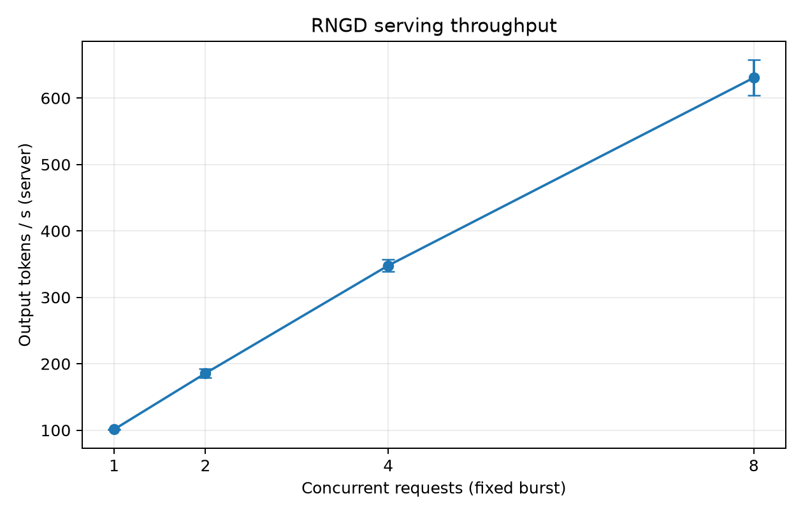
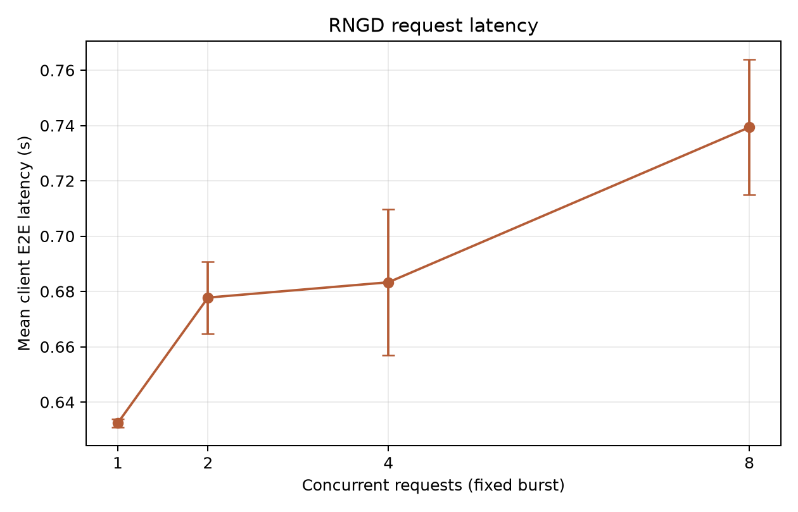
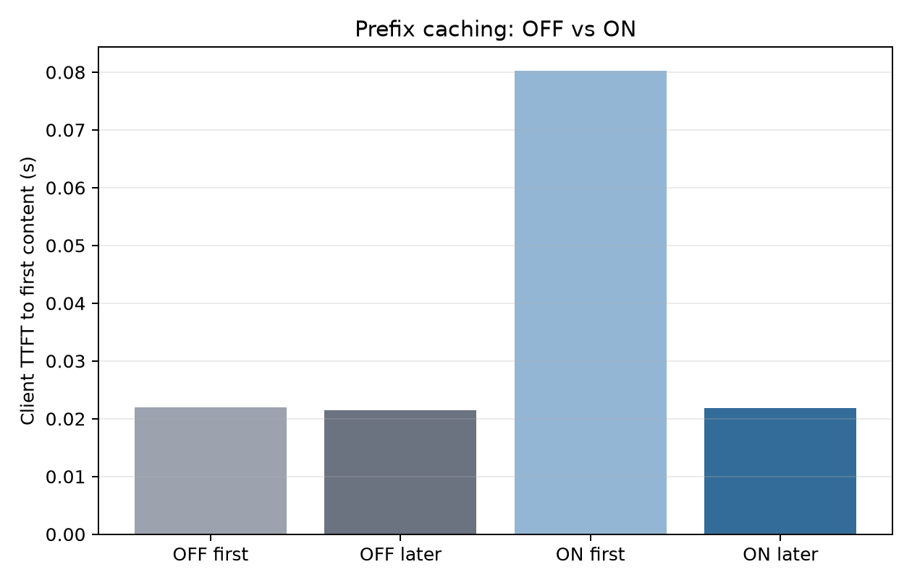

<div align="center">

# gg1th_rngd_npu_ex

**FuriosaAI RNGD NPU 위에서 LLM 추론 · 서빙 · 성능 측정까지 직접 해 본 실습 레포지토리**

GPU가 아닌 국산 NPU(RNGD)에 `Qwen3-8B-FP8`을 올려 SDK 직접 추론 → OpenAI 호환 API 서빙 → 동시성 / Prefix Caching 벤치마크 → FXB 번들 관리까지 4일간 단계별로 진행


</div>

<br>

## 목차

- [개요](#개요)
- [주요 내용](#주요-내용)
- [기술 스택](#기술-스택)
- [프로젝트 구조](#프로젝트-구조)
- [시작하기](#시작하기)
- [일자별 실습](#일자별-실습)
- [성능 측정 결과](#성능-측정-결과)
- [레퍼런스](#레퍼런스)

<br>

## 개요

| 항목 | 내용 |
|---|---|
| 하드웨어 | FuriosaAI **RNGD** (조별 NPU 1장, Linux 서버) |
| 런타임 | `furiosa-llm` 2026.4, `furiosa-smi`, `fxb` CLI |
| 메인 모델 | [`furiosa-ai/Qwen3-8B-FP8`](https://huggingface.co/furiosa-ai/Qwen3-8B-FP8) |
| 서브 모델 | `furiosa-ai/Qwen3-VL-4B-Instruct`, `RedHatAI/Meta-Llama-3.1-8B-Instruct-FP8-dynamic` |
| 기간 | 4일 (DAY 1 ~ DAY 4) |

<br>

## 주요 내용

- **NPU 환경 점검** — `furiosa-smi`로 장치 · 전력 · 온도 · 점유 프로세스 모니터링
- **메모리 예산 계산** — 파라미터 수 × 정밀도(bit)로 가중치 크기의 이론적 하한 산출
- **SDK 직접 추론** — `LLM.chat()`으로 단건 / 배치 추론, `temperature` · `top_p` 샘플링 비교
- **API 서빙** — `furiosa-llm serve`로 OpenAI 호환 서버 기동, 스트리밍 · 멀티턴 챗봇 클라이언트 구현
- **성능 벤치마크** — 동시 요청 1 / 2 / 4 / 8 버스트, Prefix Caching OFF / ON의 TTFT 비교
- **결과 시각화** — matplotlib 그래프 + Streamlit 대시보드
- **FXB 번들 관리** — 컴파일된 NPU 실행 번들(FXB) 다운로드 · 조회 · 호환성 검사

<br>

## 기술 스택

| 분류 | 사용 기술 |
|---|---|
| Language | Python 3.12, Bash |
| NPU / Runtime | FuriosaAI RNGD, furiosa-llm, furiosa-smi, furiosa-smi-py, fxb |
| Model Hub | Hugging Face Hub (`huggingface_hub`, `hf` CLI) |
| API Client | OpenAI 호환 REST API, httpx, requests, aiohttp |
| Data / Viz | pandas, numpy, matplotlib, plotly, Streamlit |
| Env | uv, python-dotenv 스타일 `.env` |

<br>

## 프로젝트 구조

```
gg1th_rngd_npu_ex/
├── check_env.py                     # 실습 환경 확인 (사용자 · Python · 경로)
├── day1_npu_chat_test/              # DAY 1 · NPU 채팅 & 메모리 예산
│   ├── memory_budget.py
│   ├── memory_budget_qwen3.py
│   ├── npu_chat_qwen3-8b.py
│   └── npu_chat_qwen3-VL-4b.py
├── day2_furiosa_sdk/                # DAY 2 · SDK 직접 추론
│   ├── 00_preflight.py              #   SDK · 장치 사전 점검
│   ├── 01_first_inference.py        #   첫 추론
│   ├── 02_batch_inference.py        #   배치 크기별 추론
│   ├── 03_sampling_experiment.py    #   샘플링 파라미터 실험
│   ├── day02_config.py
│   └── prompts.jsonl
├── day3_npu_api/                    # DAY 3 · OpenAI 호환 서빙 & 챗봇
│   ├── 01_check_server.sh           #   드라이버 · 카드 점유 · 포트 확인
│   ├── 02_run_llm_server.sh         #   furiosa-llm serve 실행
│   ├── 03_api_client.py             #   모델 목록 · Chat Completion
│   ├── 04_streaming_chat.py         #   스트리밍 챗봇
│   └── 05_multiturn_chat.py         #   멀티턴 챗봇
├── day4_benchmark_test/             # DAY 4 · 성능 측정
│   ├── 01_check_npu.sh
│   ├── 02_check_metrics.py          #   /metrics 카운터 확인
│   ├── 03_concurrency_benchmark.py  #   동시성 버스트 벤치마크
│   ├── 04_prefix_cache_benchmark.py #   Prefix Caching OFF/ON
│   ├── 05_visualize_results.py      #   그래프 생성
│   ├── 06_dashboard.py              #   Streamlit 대시보드
│   ├── day04_common.py
│   ├── data/benchmark_prompts.json
│   └── results/                     #   측정 CSV + 그래프 PNG
├── day4_fxb_ex/                     # DAY 4 · FXB CLI
│   ├── hf_fxb_list.py               #   HF Hub의 furiosa-ai FXB 목록 조회
│   └── logs/                        #   fxb show / inspect / check 결과
├── pyproject.toml
└── uv.lock
```

<br>

## 시작하기

### 사전 요구사항

- FuriosaAI RNGD가 장착된 Linux 서버 (드라이버 · 펌웨어 설치 완료)
- `furiosa-smi`, `furiosa-llm`, `fxb` CLI
- [uv](https://docs.astral.sh/uv/)

### 설치

```bash
git clone https://github.com/HwangSoon96/gg1th_rngd_npu_ex.git
cd gg1th_rngd_npu_ex

uv sync
uv run python check_env.py
```

### 환경 변수

각 실습 폴더의 `.env.example`(DAY 2는 `.env.sample`)을 `.env`로 복사 후 조별 배정값 입력

```bash
cp day3_npu_api/.env.example day3_npu_api/.env
```

```bash
export TEAM_NPU_DEVICE=npu:__        # furiosa-smi info의 장치 번호
export TEAM_SERVER_PORT=18___        # 조별 서버 포트
export MODEL_ID=furiosa-ai/Qwen3-8B-FP8
export OPENAI_BASE_URL=http://127.0.0.1:18___/v1
export OPENAI_API_KEY=EMPTY          # 로컬 교육용 서버, 실제 키 아님
```

### 서버 실행 & 호출

```bash
# 터미널 A — 서버
cd day3_npu_api && source .env
bash 02_run_llm_server.sh

# 터미널 B — 클라이언트
uv run python 03_api_client.py
uv run python 04_streaming_chat.py
```

<br>

## 일자별 실습

<details>
<summary><b>DAY 1 · NPU 채팅 테스트 & 메모리 예산</b></summary>

<br>

- `furiosa-llm serve`로 띄운 서버에 `requests`로 Chat Completion 요청
- Qwen3-8B-FP8(텍스트), Qwen3-VL-4B-Instruct(비전-언어) 두 모델 비교
- `memory_budget.py` — 파라미터 수와 bit 수로 가중치 크기의 이론적 하한 계산 (KV 캐시 · 런타임 예약 공간 제외)

```bash
uv run python day1_npu_chat_test/memory_budget.py --parameters-billions 8 --bits 8
```

</details>

<details>
<summary><b>DAY 2 · Furiosa SDK 직접 추론</b></summary>

<br>

- 서버 없이 Python 프로세스가 NPU에 모델을 직접 로딩해 `LLM.chat()` 호출
- 배치 크기 1 vs 3 비교, `furiosa-smi ps`로 점유 확인
- 같은 프롬프트에서 `temperature=0`(결정적) vs `0.8`(다양성) 출력 비교

```bash
cd day2_furiosa_sdk
uv run 00_preflight.py
uv run 01_first_inference.py
uv run 02_batch_inference.py --batch-size 3 --output B_batch3.jsonl
uv run 03_sampling_experiment.py
```

</details>

<details>
<summary><b>DAY 3 · OpenAI 호환 서빙 & 챗봇</b></summary>

<br>

- 서버가 모델을 한 번만 올리고, 클라이언트는 HTTP API로 질문하는 구조로 전환
- `--reasoning-parser qwen3`, `enable_thinking: false`로 Qwen3 사고 과정 출력 비활성화
- 스트리밍 응답, 클라이언트 측 대화 이력 관리(멀티턴 · 초기화) 구현

</details>

<details>
<summary><b>DAY 4 · 성능 측정</b></summary>

<br>

- `Barrier`로 요청 시작 시점을 맞추고 `ThreadPoolExecutor`로 동시 전송
- 토큰 수는 콘솔 글자 수가 아니라 서버 `/metrics` 카운터 차이로 계산
- `--no-enable-prefix-caching`으로 서버를 재시작해 OFF / ON 비교

```bash
cd day4_benchmark_test
uv run python 03_concurrency_benchmark.py --repeats 3 --max-tokens 64
uv run python 04_prefix_cache_benchmark.py --mode on --repeats 3 --max-tokens 48
uv run python 05_visualize_results.py
uv run streamlit run 06_dashboard.py
```

</details>

<details>
<summary><b>DAY 4 · FXB CLI</b></summary>

<br>

- **가중치(safetensors)** 와 **FXB(컴파일된 NPU 실행 번들)** 는 별개 — 서빙하려면 둘 다 필요
- `fxb download` → `fxb cache ls` → `fxb show / inspect` → `fxb check` 순서로 확인

```bash
hf download RedHatAI/Meta-Llama-3.1-8B-Instruct-FP8-dynamic   # 가중치
fxb download furiosa-ai/Meta-Llama-3.1-8B-Instruct-FP8-dynamic # FXB (~330 MiB)
fxb check RedHatAI/Meta-Llama-3.1-8B-Instruct-FP8-dynamic
```

</details>

<br>

## 성능 측정 결과

> `furiosa-ai/Qwen3-8B-FP8` · RNGD 1장 · `max_tokens=64` · `temperature=0` · 조건별 3회 반복 평균

### 동시성 버스트

| 동시 요청 | Throughput (tok/s) | 평균 E2E Latency (s) | TTFT (s) |
|:---:|---:|---:|---:|
| 1 | 101.2 ± 0.2 | 0.632 | 0.021 |
| 2 | 185.7 ± 6.6 | 0.678 | 0.035 |
| 4 | 347.9 ± 8.9 | 0.683 | 0.059 |
| 8 | **630.6** ± 26.6 | 0.739 | 0.106 |

동시 요청 1 → 8 증가 시 **처리량 약 6.2배** 증가, **E2E 지연은 약 17%** 증가에 그침 — 배치 효율이 아직 포화되지 않은 구간

<p align="center">
  
  
</p>

### Prefix Caching

| 조건 | first (재시작 후 첫 요청) | later (후속 11건 평균) |
|---|---:|---:|
| OFF | 0.022 s | 0.022 s |
| ON | 0.080 s | 0.022 s |

<p align="center">
  
</p>

<br>

## 레퍼런스

- [FuriosaAI Developer Docs](https://developer.furiosa.ai/latest/en/)
- [Furiosa-LLM · Qwen3 모델 가이드](https://developer.furiosa.ai/latest/en/furiosa_llm/models/qwen3.html)
- [Hugging Face · furiosa-ai](https://huggingface.co/furiosa-ai)
- [vLLM benchmarks](https://github.com/vllm-project/vllm/tree/main/benchmarks)
- [uv Documentation](https://docs.astral.sh/uv/)
